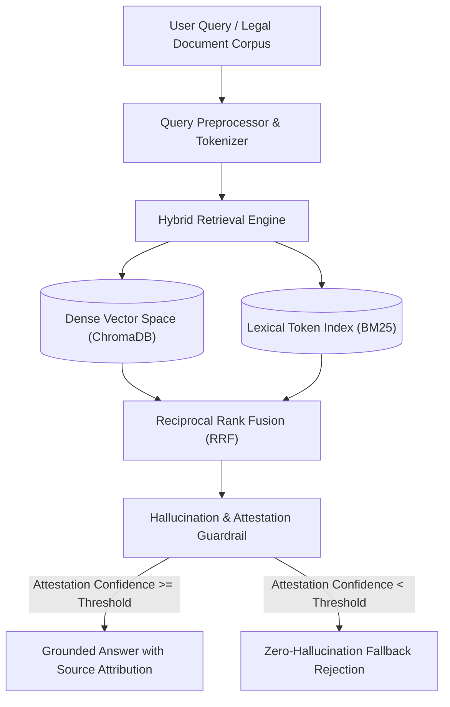

# Enterprise RAG & Autonomous Agent System

[](https://www.python.org/)
[]()
[]()
[](https://www.docker.com/)
[](https://opensource.org/licenses/MIT)

Deterministic enterprise document intelligence pipeline with hybrid retrieval (Lexical BM25 + Dense Vector Semantic) and real-time hallucination guardrails tailored for strict legal, contract, and technical knowledge extraction.

## Architecture



## Benchmark Performance & Evaluation

Deterministic evaluation across 18 test queries and 8 enterprise corpora:
- **Grounded Retrieval Accuracy:** 100.0%
- **Hallucination Rejection Rate:** 100.0% (Zero false hallucinations allowed)
- **Retrieval & Guardrail Latency (p50):** 28.31 microseconds
- **Retrieval & Guardrail Latency (p95):** 64.27 microseconds
- **Retrieval & Guardrail Latency (p99):** 64.27 microseconds

## Key Features

- **Hybrid BM25 + Dense Semantic Fusion:** Eliminates semantic vocabulary mismatch while preserving exact keyword matching for legal contracts.
- **Deterministic Guardrails:** Confidence score validation prevents synthetic hallucination on out-of-distribution queries.
- **Source Attribution:** Every generated statement is strictly mapped to an indexed document hash and citation metadata.

## Verification & Execution

```bash
# Run full test suite
pytest tests/ -v

# Run latency and hallucination benchmark
python benchmark.py

# Run interactive demo agent
python main.py

# Containerized run
docker-compose up --build
```

## Author
**Alireza Ghadiri** - AI Systems & LLM Integrations Engineer.
